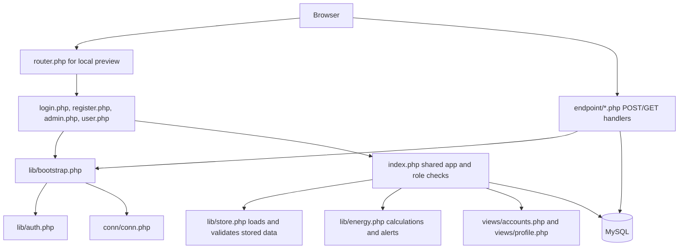

# Green Office Project Guide

This guide explains how the Green Office energy-monitoring application is put together, how a browser request travels through it, and what each account role can do. It describes the current source code, including public registration for office users. An administrator account is not available through public registration; an administrator creates or promotes accounts from Account management.

## What the application does

Green Office is a server-rendered PHP application backed by MySQL. It stores cumulative electricity meter readings, calculates consumption between readings, estimates cost and emissions, keeps a room and equipment inventory, and tracks energy-saving actions. It is designed for local office or portfolio use. Equipment and simulator values are estimates; they are not sensor measurements and are not added to meter totals.

The web pages are PHP and HTML. `assets/app.css` styles the application, `assets/app.js` adds charts and interactive calculations, and Chart.js is bundled locally. The PHP code uses PDO to communicate with MySQL. There is no frontend build step or package manager.

## Request flow



### Typical sign-in request

1. The browser requests `login.php`. It loads `lib/bootstrap.php`, which starts a session, prepares a CSRF token, and loads the database connection.
2. The user submits their email and password to `endpoint/auth.php` with the CSRF token.
3. The endpoint checks the request method and token, and `go_attempt_login()` in `lib/auth.php` checks throttling, verifies the password hash, and checks the account's active state and role.
4. Successful sign-in rotates the session ID and stores the user ID and authorization version in the session.
5. The endpoint redirects to `index.php`. `index.php` reloads the account from the database, chooses the role-specific route (`admin.php` or `user.php`), and renders the shared application with that role's navigation and permissions.

### Typical save request

1. A page form posts to an endpoint such as `endpoint/save.php` or `endpoint/accounts.php` and includes the session CSRF token.
2. The endpoint checks authentication, role/ownership, submitted values, and CSRF before changing data.
3. PDO prepared statements write to MySQL. Related reading and account operations use transactions and lock rows where required.
4. The endpoint stores a success/error message in the session and redirects back to the relevant page. The page displays that message after reload.

## Admin panel

Open `admin.php` after signing in with an active account whose role is `admin`. The URL is only a panel entry point; `index.php` and the endpoints perform the actual access checks. Hiding an admin link in the interface is not the security boundary.

### Admin navigation and use

- **Overview:** Review office-wide energy, estimated costs and emissions, target progress, daily averages, meter data signals, and the reading log. Add, edit, or delete meter readings. Import readings from CSV and export readings to CSV.
- **Rooms & equipment:** Create and maintain rooms and equipment. Enter each item's wattage, quantity, operating hours, and days per month. The page calculates estimated monthly use. A room cannot be deleted while equipment is assigned to it.
- **Savings simulator:** Compare current and proposed equipment wattage and schedules. Review estimated monthly kWh, cost, and emissions differences, then save the scenario as an action.
- **Alerts & actions:** Review office-wide meter alerts and create, edit, complete, or delete office actions. Admins can manage all actions, regardless of who created them.
- **Reports:** Filter by dates, review complete meter intervals and assumptions, export raw readings, and print or save the report as PDF through the browser.
- **Account management:** Create accounts, choose the `Office user` or `Administrator` role, activate/deactivate accounts, change account details, and set a replacement password. The app prevents an administrator from removing their own admin access and keeps at least one active administrator.
- **Office settings:** Set the office name, floor area, working days, energy target, monthly budget, tariff, and emissions factor/source. Cost and emissions figures are recalculated from the current settings; past versions of settings are not stored.
- **My profile:** View the signed-in account and change its password after confirming the current password.
- **Sign out:** Ends the session through a CSRF-protected POST request.

### Recommended admin workflow

1. Confirm the office name, floor area, target, budget, tariff, and emissions-factor source in Office settings.
2. Add rooms and equipment. Treat the resulting energy numbers as planning estimates.
3. Add meter readings using the cumulative total shown by the meter. Add readings on different dates to establish measured intervals.
4. Import existing readings by CSV when appropriate. The whole file is validated before any rows are stored; duplicate dates or invalid rows reject the import.
5. Review the overview and alerts, then add actions for proposed changes. Mark actions completed when work is done and use later readings to observe office trends.
6. Create an account for each person and assign only the access they need.

## Office user panel

Open `user.php` after signing in with an active `user` account. Public registration in `register.php` creates this role. The registration form does not allow a person to grant themselves administrator access.

### User navigation and use

- **Overview:** View office-wide energy totals, the meter chart and reading log, target progress, and equipment/action context. Users cannot change or delete readings.
- **Rooms & equipment:** View the office inventory and its estimated usage. Room and equipment changes are administrator-only.
- **Savings simulator:** Try different wattages, device counts, and schedules. Save a scenario as a personal action; the result remains an estimate.
- **My saving actions:** Review office meter alerts and manage actions created by the signed-in account. Users may add, edit, complete, or delete their own actions, but cannot edit another account's action. The owner field is assigned to the signed-in user by the server.
- **Reports:** View office-wide readings and reports, including date filters, CSV export, and printing.
- **My profile:** View account details and change the account's own password.
- **Sign out:** Ends the session.

Users cannot access administrator settings, account management, meter-reading changes, room/equipment changes, or imports through direct URLs or hand-crafted POST requests. The checks are repeated on the server in `index.php` and the endpoints.

## Registration and administrator accounts

- **Office user:** Open `login.php`, choose **Create a new account**, and submit a name, email, and matching password. Passwords require at least 12 characters and no more than 72 bytes. The account is saved as an active user and can then sign in.
- **Administrator:** An existing administrator creates or edits an account in **Account management** and sets its role to Administrator. For the first admin in a new database, run the CLI bootstrap script `scripts/create-admin.php`; it refuses to add another bootstrap admin when an active admin already exists.
- `scripts/setup.php --demo` can seed demo records and initial sample accounts in an empty database. It does not replace accounts or reset existing passwords. The login screen does not display demo credentials. Remove or deactivate unwanted seeded accounts before using a workspace as private office data.

## Data model and calculations

The main tables are defined in `green_office_db.sql` and upgraded safely by `scripts/setup.php`:

| Table | Purpose |
| --- | --- |
| `tbl_reading` | Dated cumulative meter value and whether that reading follows a reset/replacement. |
| `rooms` | Office room names and room area. |
| `equipment` | Equipment wattage, quantity, schedule, and room relationship. |
| `actions` | Improvement title, owner label, due/completion dates, status, estimate, notes, and creating user. |
| `users` | Name, unique email, password hash, role, active status, and authorization version. |
| `office_settings` | Office identity, tariffs, targets, budgets, floor area, and calculation assumptions. Internal lock rows support safe updates. |
| `auth_throttle` | Hashed email/IP buckets used to limit repeated sign-in failures. |

Important calculation rules:

- A meter reading is a cumulative total, not the consumption for the date or month. Consumption for an interval is the next verified meter total minus the previous verified total.
- A reading marked as a reset starts a new baseline. Consumption across the reset gap is unknown and excluded. Duplicate dates, invalid readings, and an unmarked decrease are flagged rather than treated as normal consumption.
- Date-filtered summaries include only complete intervals inside the selected boundaries. The app does not invent consumption for part of an interval.
- Cost is recorded kWh multiplied by the configured tariff. Emissions are recorded kWh multiplied by the configured emissions factor. They are estimates and do not include utility taxes/fixed charges or the office's full emissions inventory.
- Monthly targets and budgets are prorated by the covered calendar days, accounting for month lengths.
- Equipment estimate = watts × quantity × hours per day × days per month ÷ 1,000. It is separate from measured meter readings.
- A completed action can show weighted office daily averages before and after completion when complete intervals exist within 90 days on each side. This observation does not prove the action caused a change.
- Alerts are rule-based signals, such as stale readings, questionable/reset data, a latest interval exceeding its prorated target, or a daily average increase. They are prompts for review, not automated diagnosis.

## File-by-file map

### Root PHP pages

| File | Responsibility |
| --- | --- |
| `index.php` | Shared authenticated application. Loads data, enforces panel/page permissions, calculates page values, builds navigation, and renders each page. |
| `admin.php` | Sets the requested panel to `admin`, then includes `index.php`. |
| `user.php` | Sets the requested panel to `user`, then includes `index.php`. |
| `login.php` | Renders sign-in, shows flash errors/success, and links to registration. |
| `register.php` | Renders public account creation; new accounts are users, not admins. |
| `message.php` | Shared safe error/status page used by bootstrap and endpoints. |
| `check.php` | Repeatable project self-checks for important business rules without changing database data. |
| `router.php` | Local built-in-server route allow-list. Serves approved PHP entry points/assets and returns 404 for other paths. |

### Shared PHP libraries and connection

| File | Responsibility |
| --- | --- |
| `conn/conn.php` | Creates the PDO MySQL connection using `GREEN_DB_HOST`, `GREEN_DB_PORT`, `GREEN_DB_NAME`, `GREEN_DB_USER`, and `GREEN_DB_PASSWORD`. |
| `lib/bootstrap.php` | Loads shared libraries, starts the `GREENOFFICE` session, initializes CSRF state, defines escaping/flash helpers, and loads the PDO connection. |
| `lib/auth.php` | Builds local app URLs; validates accounts, sessions, roles, passwords, and emails; handles session reset, admin guards, and login throttling. |
| `lib/store.php` | Loads database records and settings, validates form fields/IDs/dates, protects meter history changes, and guards CSV cells against spreadsheet formulas. |
| `lib/energy.php` | Defines default settings and pure domain calculations for dates, reading validation, intervals, summaries, targets, equipment, scenarios, alerts, and action comparisons. |

### Form and download endpoints

| File | Responsibility |
| --- | --- |
| `endpoint/auth.php` | Handles sign-in, sign-out, and password changes. Uses CSRF checks, session rotation, auth-version revocation, and throttling helpers. |
| `endpoint/register.php` | Validates and inserts a new active `user` account in a transaction. It rejects duplicate email addresses. |
| `endpoint/accounts.php` | Admin-only create/edit/deactivate/role/password management for user accounts. Rejects self-demotion and removal of the last active admin. |
| `endpoint/save.php` | Main application mutation handler: readings, CSV import, office settings, rooms, equipment, and actions. Checks method, session, CSRF, role, ownership, and input constraints. |
| `endpoint/export.php` | Authenticated GET endpoint that streams filtered raw meter readings as a CSV download. |
| `endpoint/add-reading.php` | Legacy reading form adapter that delegates to `endpoint/save.php`; the shared handler still enforces POST and CSRF. |
| `endpoint/delete-reading.php` | Legacy delete adapter. GET deletion is deliberately unsupported; the shared handler requires an authorized POST. |

### Views and frontend assets

| File | Responsibility |
| --- | --- |
| `views/accounts.php` | Admin account table and create/edit form. The endpoint validates and performs changes. |
| `views/profile.php` | Shared profile details and password-change form for both roles. |
| `assets/app.css` | Responsive layout, color system, forms, tables, dashboards, auth pages, and print styles. |
| `assets/app.js` | Confirmation prompts, print button, Chart.js graphs, live savings-scenario calculations, and action completion-date requirement. |
| `assets/vendor/chart.umd.js` | Bundled Chart.js library used to draw energy charts without a CDN. |
| `assets/vendor/Chart.LICENSE.md` | License information for the bundled chart library. |
| `assets/readings-template.csv` | Downloadable CSV template for meter-reading imports. |

### Database, setup, and tests

| File | Responsibility |
| --- | --- |
| `green_office_db.sql` | Non-destructive base table definitions. It contains no `DROP TABLE` statements. |
| `scripts/setup.php` | CLI-only schema create/upgrade. Preserves existing readings, adds supporting columns/indexes, and seeds sample data/accounts only when explicitly requested with `--demo` and the workspace is empty. |
| `scripts/create-admin.php` | CLI-only first-administrator bootstrap. It refuses if an active admin already exists. |
| `scripts/start-local.sh` | Shell-based isolated local startup helper documented for the project's Unix/macOS workflow. On Windows/XAMPP, use the configured MySQL service and PHP server instead. |
| `SETUP.md` | Setup, configuration, operational notes, validation commands, screen summaries, and calculation assumptions. Some older statements about registration may not reflect the current `register.php` flow; this guide documents the current code. |
| `tests/auth.py` | Authentication/authorization integration checks. |
| `tests/integration.py` | Backend integration runner for a dedicated test database and local test server. Review its database target before running it. |
| `tests/browser.py` | Browser-level checks for the primary application workflows. |
| `tests/browser_roles.py` | Browser checks of role-based UI and authorization behavior. |

## Local run and validation

The current XAMPP workspace uses MySQL on port `3307`, the `green_office_portfolio` database, and the PHP built-in server at `http://127.0.0.1:8085`. Set the same database variables in the shell used to run setup and the server. Example PowerShell commands from the project folder:

```powershell
$env:PATH = "C:\xampp\php;C:\xampp\mysql\bin;$env:PATH"
$env:GREEN_DB_HOST = '127.0.0.1'
$env:GREEN_DB_PORT = '3307'
$env:GREEN_DB_NAME = 'green_office_portfolio'
$env:GREEN_DB_USER = 'root'
$env:GREEN_DB_PASSWORD = ''
php scripts/setup.php
php -S 127.0.0.1:8085 router.php
```

Open `http://127.0.0.1:8085/login.php`. Run `php check.php` for the self-check. The integration/browser tests use their own assumptions and may create or remove test data; read the test headers and confirm the target database before running them.

## Security and operating notes

- Sessions are server-side and use an HTTP-only, same-site cookie. State-changing forms require POST and a CSRF token.
- Passwords are stored as PHP password hashes. The password text is not stored in the database.
- Login failures are throttled by hashed email/IP keys. Account role, active state, and authorization version are rechecked from MySQL on authenticated requests.
- Editing a user's role, active state, or password increments its authorization version and revokes that user's other sessions.
- The user interface is not the only permission control. Admin-only actions are rejected server-side even if a user submits directly to an endpoint.
- The PHP built-in server and local development router are for local development, not production hosting. Keep the server bound to `127.0.0.1` for local use.
- Use private credentials and a restricted database account for real office data. Demo sample data is not a real building measurement set.